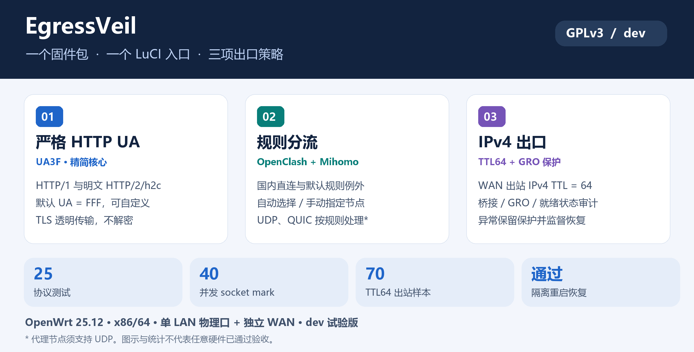
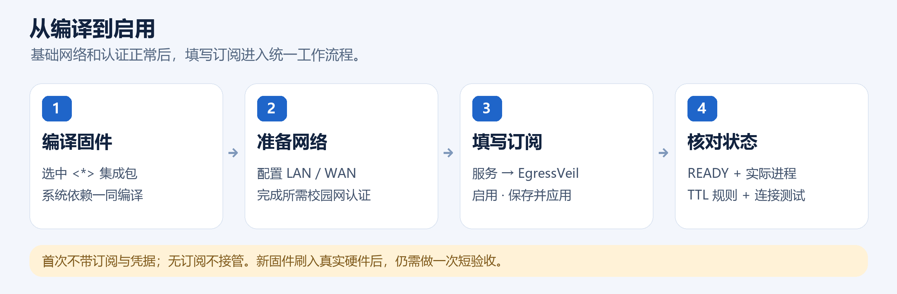

# EgressVeil

**一个固件包，一页管理：严格 HTTP UA · OpenClash/Mihomo 分流 · IPv4 TTL**

[GPLv3](LICENSE) · **实验分支 `dev`** · OpenWrt 25.12 · x86/64



## 能开箱即用吗？

**目标使用方式：刷机后完成基础网络和认证，填写订阅即可启用。** 编译时选入本包及依赖，正常情况下刷机后无需分别安装 UA3F、OpenClash、Mihomo 或手写接管规则。

当前 `dev` 已完成单 APK 编译和隔离环境验证；**新固件在真实 r8169 硬件上的长期运行仍待验收**。这是具备首次激活流程的试验版，不能直接承诺所有硬件和网络都零配置可用。

| 你需要先完成 | EgressVeil 负责完成 |
|---|---|
| 编译正确的 x86/64 固件，选入依赖 | 提供统一软件包、固定核心和公开路由数据 |
| 配置 LAN/WAN、DHCP、SSH，确保基础上网正常 | 建立接管、路由、桥/GRO 与 TTL 策略 |
| 校园网等环境自行完成认证 | 不携带或构造你的学校认证账号与请求 |
| 提供有效节点订阅 | 导入、探测、自动/手选节点，生成规则与 DNS 配置 |
| 满足下方硬件和 IPv4 条件 | 激活前检查，不符合时拒绝启用受保护路径 |



## 已包含、已实现什么？

| 功能 | 当前实现 | 验证与条件 |
|---|---|---|
| **统一管理** | 一个 `luci-app-egressveil` APK；一页配置订阅、节点、UA、TTL，显示实际进程与 TTL 规则 | 页面渲染、后端配置和 API 已验证 |
| **精简 UA3F** | 约 4MB 核心，1080/1081 双透明入口；HTTP/1.0、HTTP/1.1、明文 HTTP/2/h2c | 25 个顶层协议测试通过 |
| **明文 HTTP UA** | 默认统一为 `FFF`，可修改；已识别 HTTP 解析失败则关闭连接 | 接收端及 WAN 明文头已验证；加密内层不记作改写证据 |
| **TCP 分流** | OpenClash 后端＋固定 Mihomo v1.19.32；fake-ip 恢复域名后按规则选择出口 | 真实地址、fake-ip DIRECT／代理路径已验证 |
| **国内／国际策略** | 默认国内直连，其余进入 `Switch`；保留 Microsoft 关键词、LAN 等直连例外 | 具体出口由规则命中决定，不按地理名称作绝对保证 |
| **节点选择** | 自动或手选；探测默认 30 秒，可选 15–300 秒，容差 100ms；订阅每小时刷新 | 手动／自动切换已验证 |
| **UDP／QUIC** | 统一交给 Mihomo，恢复 fake-ip 并按规则直连或代理 | DIRECT 16／256／1200 字节回包通过；节点须支持 UDP；真实 HY2／QUIC 完整矩阵待验收 |
| **DNS 策略** | 国际域名代理 DoH，国内及节点引导解析保留 DIRECT；实际生成配置启动前校验 | 默认 DoH 跟随自动选择组，手选业务节点时不保证两者是同一节点 |
| **IPv4 TTL** | WAN 出站固定 `64`，含 GRO 防绕过就绪检查；首版仅开放 TTL64 | 隔离环境 70 个出站 IPv4 样本均为 64，抓包内核丢包 0 |
| **生命周期** | 无订阅不接管；首次激活失败恢复；核心崩溃保留保护并由 procd 拉起；重启恢复 | 故障恢复、重载、应用锁和重启已验证 |

**HTTPS/TLS 透明传输，不解密、不安装 MitM 证书。** 非 HTTP 协议标识和 TCP 等其他特征不属于统一 UA 的覆盖范围。统一 UA 和 TTL 不等于上游无法识别路由器。

## 一页管理什么？

入口：**服务 → EgressVeil**。

| 页面项目 | 用法 |
|---|---|
| 启用 EgressVeil | 控制整体接管；没有有效订阅时无法成功激活 |
| 节点订阅链接 | 填自己的订阅，界面遮蔽显示；无需替换整套 YAML |
| 代理节点／策略 | 首次用自动选择；激活后刷新即可看到手选节点 |
| 探测周期 | 默认 30 秒，范围 15–300 秒 |
| HTTP UA 开关／值 | 默认开启、`FFF`；单独关闭仍保留分流与 TTL |
| WAN 出站 IPv4 TTL | 当前严格配置固定 `64` |
| LAN／WAN 逻辑接口 | 默认 `lan`／`wan`，不是物理网卡名 |
| 日志级别 | ERROR／WARN／INFO／DEBUG |
| 状态 | 区分最近应用结果、当前 UA3F/Mihomo 进程及 TTL 规则是否在位 |

保存应用后刷新，核对 **`READY`、当前进程、TTL64 规则**，再做连接检查。试验版保存应用会重载内部服务，已有连接可能短暂重连。

## 编译进固件

1. 准备 OpenWrt 25.12 源码，更新并安装官方 feeds。
2. 将 **`package/luci-app-egressveil`** 整个目录复制到源码的 **`package/`**；不要同时选入独立 UA3F/OpenClash 或旧套件。
3. `make menuconfig`：选 **x86 → x86_64**，在 **LuCI → Applications** 将 **`luci-app-egressveil` 选为 `<*>`**。
4. 使用 **`dnsmasq-full`**，取消普通 `dnsmasq`；在 **Target Images → Root filesystem partition size** 设置 **512MiB 或更大**。
5. 保留标准内核 IPv6 编译支持以满足 fw4 依赖；本版在网络配置层使用 IPv4。
6. 执行正常下载和编译流程：

```sh
make defconfig
make download -j8
make -j$(nproc)
# 失败时查看具体错误：make -j1 V=s
```

包内预置精简 UA3F、Mihomo、OpenClash 后端和公开规则数据。**OpenWrt 工具链、LuCI、Ruby、iptables/nftables、内核模块等系统依赖仍需事先下载**；Makefile 会声明并选入依赖，完整 OpenWrt 构建环境不在本仓库中。

## 刷机后的四步

1. 配置 LAN/WAN、DHCP、SSH，以及需要的校园网认证，确认普通上网正常。
2. 确认符合下方拓扑，关闭可对外使用的 IPv6 路由；发现 IPv6 默认路由时本版拒绝激活。
3. 进入 **服务 → EgressVeil**，填写订阅、勾选启用、保存并应用。
4. 刷新检查状态，测试国内及代理访问；新硬件做一次短验收。

## 支持范围与待验收项

| 条件 | 当前范围 |
|---|---|
| 系统／架构 | OpenWrt 25.12、x86/64、firewall4/nftables |
| 拓扑 | 独立 WAN＋只有一个物理成员的 LAN 桥 |
| 物理端口 | `eth0`／`eth1`，可交换角色；逻辑接口名可配置 |
| LAN 驱动 | `r8169`；`virtio_net` 用于隔离实验 |
| WAN 类型 | 物理以太网上的普通 DHCP／静态 IPv4；PPPoE 待适配 |
| 需要另外适配 | 多 LAN 物理口、VLAN、其他网卡／桥、可用 IPv6 路由 |
| 仍待实测 | 新内核在真实 r8169 上的长测、独立跨网 P2P、真实 HY2／QUIC 完整矩阵 |
| Docker／打印机 | 不随包提供；新增 Docker／桥前须停用并复核，不默认兼容任意网络模型 |

不附带校园网工具、学校账号、系统登录密码、SSH 身份、真实订阅／节点密钥、原设备租约、客户端名单或业务日志。旧设备的个人例外规则不复制。

UA3F 的旧多模式、MitM、NFQUEUE、BPF offload、IPID／时间戳伪装、自定义正文／URL规则及旧统计前台已移除。OpenClash 独立前台由统一页面替代，内部仍保留 procd 子实例。见[架构与删减范围](docs/architecture.md)。

## 验证证据与源码

已完成单 APK 编译、协议回归、实际 socket mark、fake-ip 双路径、UDP/ICMP、WAN UA/TTL、节点选择、故障恢复、重载、重启及 LuCI 渲染。完整结果与已知提示见[实验验证记录](docs/validation.md)。

| 内容 | 位置 |
|---|---|
| 精简核心与协议测试 | [`core/`](core/) |
| 单一固件软件包 | [`package/luci-app-egressveil/`](package/luci-app-egressveil/) |
| 桥接／GRO／TTL 辅助源码 | [`helpers/`](helpers/) |
| 固定 Mihomo 对应源码 | [`sources/`](sources/) |
| 文件校验 | [`ASSETS.json`](ASSETS.json) |
| 维护、排错及停用 | [维护文档](docs/maintenance.md) |

## 许可证与致谢

自有代码和整体集成采用 **GPLv3**，见 [LICENSE](LICENSE)。UA3F（SunBK201 及贡献者）、OpenClash（vernesong，MIT）、Mihomo（MetaCubeX 及贡献者）的版权和许可分别保留，见 [NOTICE](NOTICE) 与 [LICENSES](LICENSES)。

`dev` 用于试验，真实硬件及长期运行验收后再合并 `main`。设备激活后的 `/etc`、订阅、缓存、密钥与日志属于私有状态，禁止重新提交到源码仓库。
