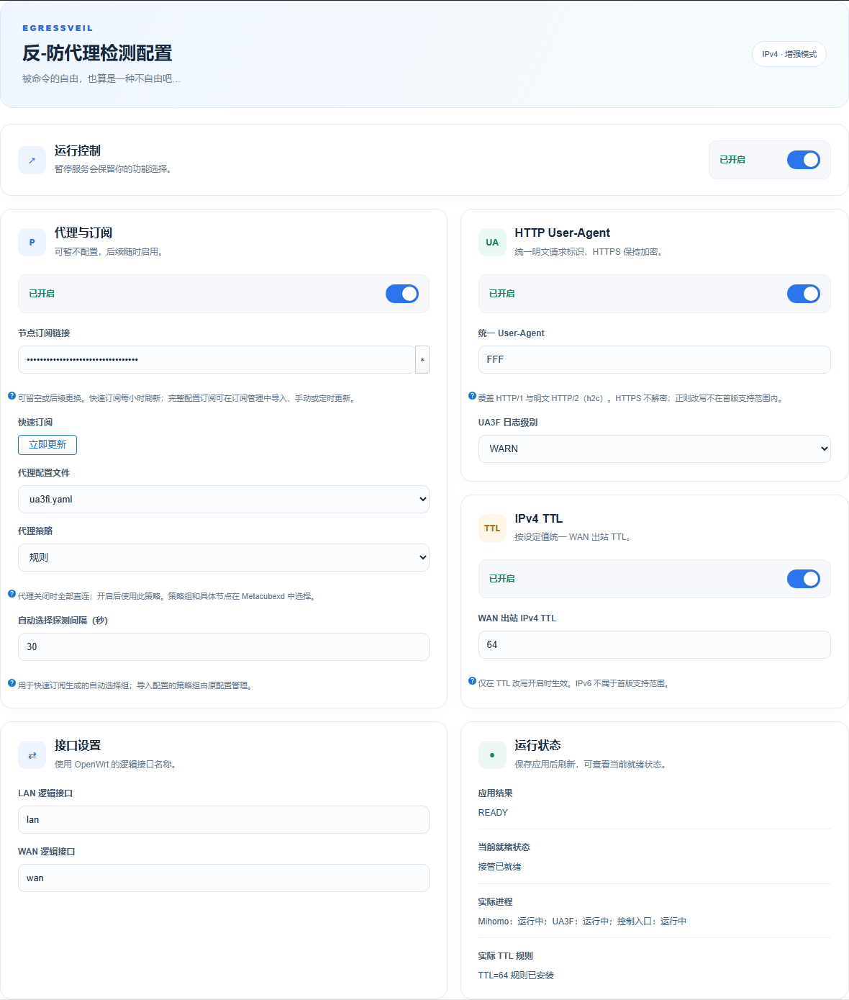
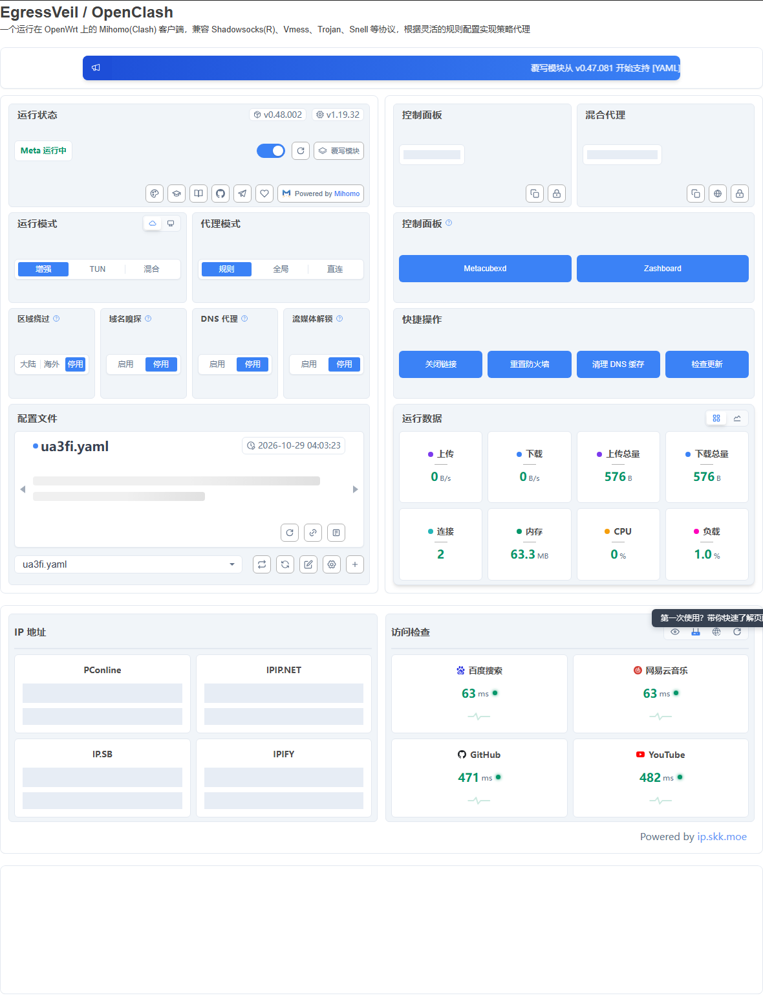

# EgressVeil

把 UA3F、OpenClash 和 IPv4 TTL 放在同一个 LuCI 插件里。开关、接管顺序、防火墙和服务恢复由插件协调，不用再分别拼接几套规则。

[下载 1.0.0](https://github.com/Lunaris617/EgressVeil/releases/tag/v1.0.0) · [安装说明](docs/installation.md) · [工作原理](docs/architecture.md) · [验证记录](docs/validation.md) · [GPLv3](LICENSE)

## 按需要开，不用的可以关

| 功能 | 开启后 | 关闭后 |
|---|---|---|
| 代理 | fake-IP 接管，按规则或全局策略选择出口 | Mihomo 继续运行，业务流量全部直连 |
| UA 改写 | 明文 HTTP 使用填写的 UA，默认建议 `FFF` | 撤销 UA 接管，保留正常转发和分流 |
| IPv4 TTL | WAN 发出前改为指定值，默认 `64` | 撤销本插件的 TTL 修改 |

没有订阅也能用。首次引导可以跳过代理，之后再添加；UA 和 TTL 都不是必选项。**关闭代理与停止 Mihomo 核心是两回事**，UA 桥接和 fake-IP 地址还原仍需要核心运行。



图为隔离环境中的界面，订阅和地址已隐藏。安装后在「服务 → EgressVeil → 配置引导 / UA / TTL」完成设置。

## 明文先改，再交给 Clash

```text
LAN 客户端 / 路由器本机公网 TCP
  → UA3F 前置改写（开启时）
  → Mihomo 还原 fake-IP、匹配规则
  → 直连，或封装到代理节点
  → TCP 最终出口处理
  → IPv4 TTL 改写（开启时）
  → WAN
```

代理目标里的明文 HTTP 也在封装前处理。支持 HTTP/1.0、HTTP/1.1，以及明文 HTTP/2／h2c。HTTPS 不解密，不安装中间人证书；HTTPS 内的浏览器 UA 不改写。UDP 由 Mihomo 按规则和节点能力处理，不经过 UA3F 的 TCP 引擎。

管理连接、LAN 内部通信、本机回复和必要本地服务保留各自的路径。NTP、TCP 时间戳、SIP 和 STUN 等协议标识不属于 HTTP UA 改写功能。

## OpenClash 的日常功能还在

保留概览、配置与订阅管理、规则和策略组、节点选择、日志、IP 查询及访问检查。Metacubexd 已随包提供，不需要第一次打开时再下载。



- 快速订阅可在引导页添加、更换和手动刷新；也可导入完整 YAML。
- 修改 UA 或 TTL，不覆盖已有节点和用户规则。切到直连会保留此前的代理配置。
- 自签证书订阅保留原始链接中的 `pinSHA256`，不把某一次指纹写死在插件里。
- 配置页先显示表单，后台再读取就绪状态；保存应用仍执行完整检查和回退流程。
- 与接管冲突的 TUN、混合模式、独立核心替换和部分更新操作受限制。升级时更新完整 EgressVeil 包。

## 安装

Release 提供 x86_64 APK、发行公钥、SHA256 和可直接放入 OpenWrt 源码的 package 压缩包。

已有独立 UA3F、OpenClash 或旧整合包时，先备份并按[安装说明](docs/installation.md)处理冲突，不要强制覆盖文件。APK 包含核心、面板和规则资源；Ruby、内核模块等系统依赖仍由固件或软件源提供。内核模块必须匹配正在运行的内核，不能跳过 ABI 检查。

1. 确认路由器基础联网正常，并保留独立管理通道。
2. 校验下载文件，安装发行公钥和 APK。
3. 打开配置引导，分别选择代理、UA、TTL，填写逻辑接口名称；通常是 `lan`、`wan`。
4. 保存并应用，检查应用结果与实际就绪状态，再测试自己的常用业务。

订阅、代理节点、系统密码和校园网账号由使用者配置，发行包不附带这些数据。

## 编译进固件

将 package 压缩包内的 `luci-app-egressveil` 放进 OpenWrt 的 `package/`，在 **LuCI → Applications** 选中。使用 `dnsmasq-full`，取消普通 `dnsmasq`；不要同时选入独立 UA3F 或 OpenClash。

```sh
make defconfig
make download -j8
make -j$(nproc)
```

包内带有固定版本的预构建核心。只打固件包不需要再编译 Go；修改核心时，源码、依赖和构建脚本也在仓库中。离线构建仍需提前准备 OpenWrt 工具链和系统依赖源码。

## 首版支持范围

1.0.0 以实际部署后修正、验证过的运行方案为基线，包含前置 UA、本机公网接管、订阅启动、桥接恢复、统计连接和配置页响应修复。现机程序与发行源的比对记录见 [runtime-baseline.json](release/runtime-baseline.json)。

目前支持 **OpenWrt 25.12、x86/64、firewall4/nftables、IPv4**。已用的拓扑为独立以太网 WAN、只有一个物理成员的 LAN 网桥；r8169 为实体设备基线，virtio_net 用于隔离验证。**PPPoE、VLAN、多物理 LAN、其他网卡及可用 IPv6 路由尚未适配。** 不满足条件时会拒绝启用，不会自动放宽保护。

统一 UA 和 TTL 不等于上游无法识别路由器。内核、网络和节点条件不同，安装后仍应自行验收；不要把某次测试结果当作所有硬件与业务的保证。

## 版权与源码

EgressVeil 使用 GPLv3。UA3F、OpenClash、Mihomo、Metacubexd 等上游项目的版权和原许可证均保留，具体版本、修改范围和源码位置见 [NOTICE](NOTICE) 与 [LICENSES](LICENSES)。

校园网认证插件、打印扫描服务、主题及设备私人配置不在本包内。
