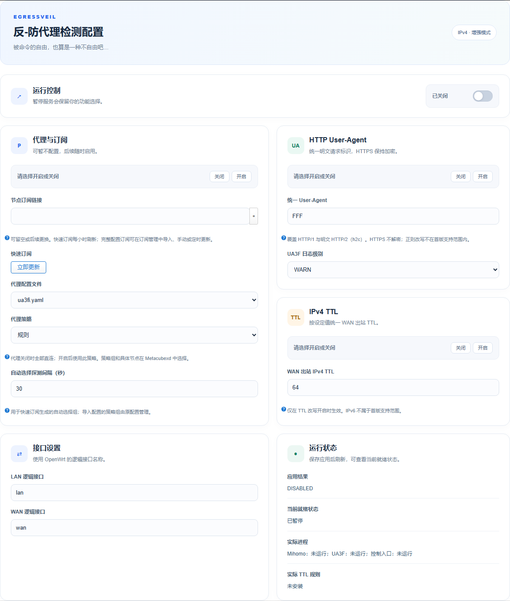
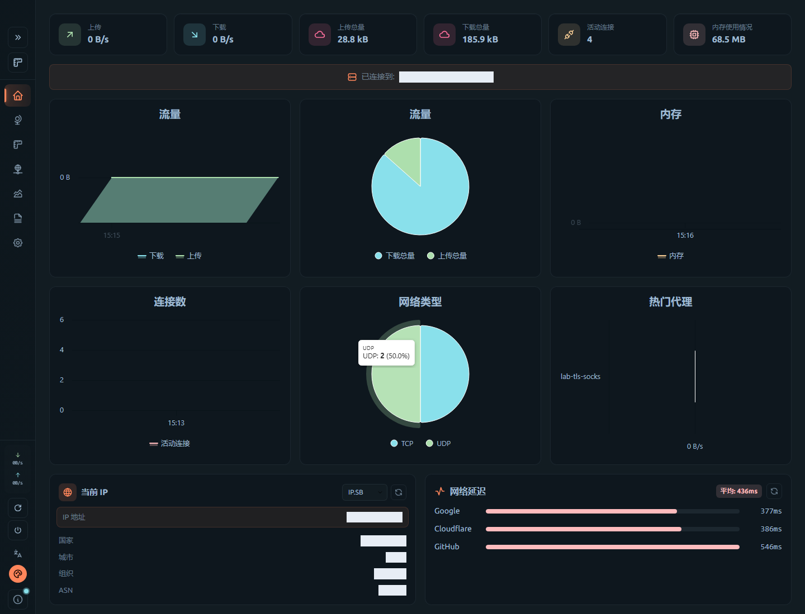

# EgressVeil

**UA、TTL 与 OpenClash 的统一配置入口。**

[GPLv3](LICENSE) · `dev` · OpenWrt 25.12 · x86/64

通过卡片和滑块按需开启代理、明文 HTTP UA 和 IPv4 TTL。接管、防环、策略路由及服务恢复由插件处理，无需分别编写 UA3F 与 OpenClash 的防火墙规则。

## 先选功能，再开始使用

首次引导要求分别选择三项功能，不默认开启。没有代理订阅也可以完成设置，以纯直连方式运行。



| 功能 | 开启 | 关闭 |
|---|---|---|
| 代理 | fake-IP 增强接管；支持规则、全局策略和手动选节点 | Mihomo 保留运行，业务流量全部 DIRECT |
| HTTP UA | HTTP/1 与明文 HTTP/2 / h2c 使用指定 UA，建议 `FFF` | 停止 UA3F，撤销 UA 接管，保留正常转发 |
| IPv4 TTL | WAN 出站统一为指定值，默认 64，范围 1–255 | 撤销插件的 TTL 改写及相关保护 |

三个开关互相独立，八种组合均可使用。fake-IP 用于地址映射和域名恢复，与是否建立代理连接是两件事。


明文 HTTP 在 Clash 加密前改写，覆盖 fake-IP 客户端及路由器本机公网请求；最终出口处理仍保留。HTTPS/TLS 不解密，浏览器在 HTTPS 内发送的 UA 不改写。TTL 关闭后，用户态代理新建连接仍可能自然使用系统默认 TTL；关闭表示不再强制改写，并不表示代理保留客户端原始 IP 报文。

## 保留熟悉的 OpenClash

原有概览、插件设置、订阅管理、配置导入编辑、日志、IP 查询和访问检查保留在同一入口。Metacubexd 随包提供，无需首次联网下载；可手动选择策略组、节点或自动选择。




- **快速订阅**：引导页添加或更换链接；每小时刷新，提供“立即更新”。默认自动探测 30 秒，支持 15–300 秒。
- **完整配置订阅**：使用 OpenClash 订阅管理，保留手动和定时更新；也可导入自己的 YAML。
- **配置保留**：修改 UA 或 TTL 不覆盖节点、策略组和用户规则；关闭代理保留此前代理配置，后续可恢复。
- **高级设置**：保留兼容选项。接管端口、桥接、防环及相关标记统一管理；TUN、混合接管、IPv6 和独立核心替换不开放。
- **统一升级**：更新完整 EgressVeil 包；订阅、规则数据更新与整包升级分开管理。

默认快速配置保留国内 DIRECT、其他流量进入可选策略组的规则；实际出口由命中规则、代理模式和节点能力决定。导入配置沿用用户规则。公网 TCP 先按开关完成 UA 处理，再交给 Mihomo 判定出口，并保留最终 UA 出口检查；不再通过独立的内核地理旁路覆盖用户规则。

## 编译进固件

1. 准备 OpenWrt 25.12 源码，更新并安装官方 feeds。
2. 将本仓库 `package/luci-app-egressveil` 复制到源码的 `package/`。不要同时选入独立 UA3F、OpenClash 或旧整合包。
3. 在 `make menuconfig` 选择 **x86 → x86_64**，然后在 **LuCI → Applications** 将 **luci-app-egressveil** 选为 `<*>`。
4. 选择 `dnsmasq-full`，取消普通 `dnsmasq`；根文件系统建议至少 512 MiB。
5. 保留标准内核 IPv6 编译支持以满足系统依赖；本版运行于没有可用 IPv6 路由的网络。

```sh
make defconfig
make download -j8
make -j$(nproc)
# 构建失败时定位错误
make -j1 V=s
```

UA3F、Mihomo、OpenClash 界面、仪表盘和公开规则数据已包含在包内。Go 不参与普通固件打包。工具链、LuCI、Ruby、内核模块等系统依赖仍须提前下载；Makefile 会选择依赖，但不会提供整套 OpenWrt 构建环境。

## 刷机后使用

1. 配置基础 LAN/WAN、DHCP、系统登录及所需上网认证，确认基础网络正常。
2. 打开 **服务 → EgressVeil → 配置引导 / UA / TTL**。
3. 分别选择代理、UA、TTL。没有订阅时选择“暂不配置，全部直连”。需要代理时填写快速订阅，或先在配置管理导入完整配置。
4. 启用 EgressVeil，保存并应用。完成后刷新本页，核对“接管已就绪”、实际进程和 TTL 规则。
5. 需要选择节点时，从概览打开 Metacubexd。整体暂停会撤销接管并保留功能选择，再次启动按原选择恢复。

应用配置和切换代理模式会重载服务，现有连接可能重连。节点选择使用面板原生接口，不要求重新生成整份订阅配置。

## 支持范围

| 项目 | 当前范围 |
|---|---|
| 系统 | OpenWrt 25.12，x86/64，firewall4/nftables |
| 基线拓扑 | 独立物理 WAN；LAN 桥只有一个物理成员；默认逻辑接口 `lan` / `wan` |
| 网卡 | `eth0` / `eth1`；LAN 驱动 r8169，virtio_net 用于隔离测试 |
| WAN | 普通以太网 DHCP / 静态 IPv4 |
| 配置文件 | 普通 YAML；加密配置先解密为 YAML 后导入 |
| 尚待适配 | 多物理 LAN、VLAN、PPPoE、其他网卡和可用 IPv6 路由 |

`dev` 已完成实际 APK 构建、八种功能组合、协议回归、面板与生命周期验证。实体 r8169 新固件长测、独立跨网 P2P、真实 HY2/QUIC 完整矩阵及更多硬件兼容性仍待验收，当前不作为商业生产认证版本。

本包不附带上网账号、系统密码、订阅凭据、租约、客户端名单或业务日志。校园网认证、打印服务和 Docker 不在本包内。统一 UA 与 TTL 也不代表上游无法识别网络设备。

[验证记录](docs/validation.md) · [工作原理](docs/architecture.md) · [维护与回滚](docs/maintenance.md) · [版权与固定版本](NOTICE)
